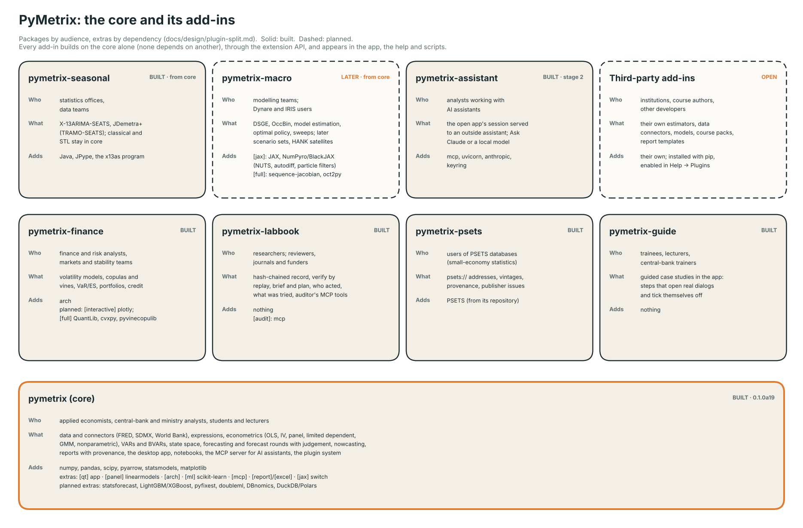

# Splitting the core into plugins

Design note, 29 October 2026 · pymetrix 0.1.0a8 at `main` 3266e7e · a proposal. *Built since:* the first split,
seasonal adjustment with external engines (`packages/pymetrix-seasonal`, November 2026; see "Built" under the
recommendation). Parallel tests in CI (pytest-xdist) were already in place; the lazy `scipy.stats` import is not done.

## The question

The core package has grown to 231 modules and about 73,000 lines. Would moving advanced components into plugins
(like `pymetrix-finance` and `pymetrix-labbook`) make pymetrix faster or easier to maintain, and what would it cost
users who install it?

## Short answer

- **Speed:** splitting gains almost nothing. Code that is installed but not imported costs nothing, and the heavy
  libraries outside the base stack (statsmodels, matplotlib, scikit-learn, arch, linearmodels, Qt, Java) already
  load only when first used. Start-up time is pandas and SciPy (below), so it is cheaper to fix by making one
  import lazy than by restructuring.
- **Maintenance:** splitting can help. It is worth it where a component brings its own fragile dependencies, a
  distinct audience, or slow tests. Size alone is not a reason.
- **Installation:** splitting adds some cost, which can be contained. It stays one command
  (`pip install pymetrix[all]`), with a clear message when a feature's plugin is missing. The mechanism exists and
  two plugins already use it.

Recommendation, in order:
1. Make the import lazy, and run the tests in parallel in CI.
2. Move seasonal adjustment with Java/X-13 into a plugin.
3. Consider the macro-modelling stack, only once its interfaces settle.
4. Leave the rest in the core.

## What the core is now

| Measure | Value |
|---|---|
| Modules | 231 |
| Lines | 72,804 |
| Source size | 5.0 MB |
| `import pymetrix`, warm cache | 1.2 to 1.3 s |
| `import pymetrix`, cold cache | 3.2 to 3.4 s |
| Modules loaded by `import pymetrix` | 1,427 (nearly all from pandas, SciPy and NumPy) |

Third-party libraries by number of pymetrix modules that import them (eager = at module import, lazy = inside a
function):

| Library | Modules | Eager | Note |
|---|---|---|---|
| numpy | 127 | 120 | base |
| pandas | 119 | 107 | base |
| scipy | 77 | 67 | base; `scipy.stats` is most of its import cost |
| statsmodels | 5 | 0 | all through `pymetrix.adapters` |
| matplotlib | 6 | 0 | only when a figure is made |
| PySide6 | 9 | 3 | the app only (`pymetrix.ui`) |
| JPype (JDemetra+) | 2 | 0 | TRAMO-SEATS; needs Java |
| arch, linearmodels, scikit-learn | via `pymetrix.ext` | 0 | optional extras |
| openpyxl, python-docx, ipywidgets, qtconsole, jedi, pyflakes | 1 each | 0 | optional features |

### Where the import time goes

From `python -X importtime -c "import pymetrix"` (cold, cumulative):

| Import | Time | Pulled in by |
|---|---|---|
| pandas | 1.08 s | `data.dataset` (needed) |
| `scipy.stats` | about 0.9 s | `estimation.fitted`, eagerly |
| pyarrow | 0.21 s | pandas, through its compatibility layer |
| pymetrix's own modules | well under 0.5 s together | |

Making `scipy.stats` lazy in `estimation.fitted` (and the few other modules that import it at the top) would cut
about 0.7 to 0.9 s from a cold start, which is more than any split would.

## Dependency map of the candidates

For each candidate group:
- **Into the group:** core modules that import it, eager or lazy; each one has to change if the group moves.
- **Group uses:** how many core modules the group imports; each becomes a public interface the core must keep.

### A. Seasonal adjustment with external engines

| Modules | Lines | Extra dependencies |
|---|---|---|
| `seasonal`, `jdemetra`, `commands.seasonal` | 947 | JPype and Java (JDemetra+, TRAMO-SEATS), the X-13 binary, dateutil |

- **Into the group:**
  - `pymetrix` (eager re-export);
  - `commands` (eager, registers the dialog);
  - `data.dataset`, `data.derived` and `ui.qt` (lazy).
- **Group uses:** 12 core modules: `errors`, `forms`, `plugins`, `adapters`, `filters`, `progress`, `data`,
  `data.derived`, `metadata`, `commands.registry`, `calls`, `codec`.
- **Assessment:** the best first split.
  - Small, with a clean boundary, and it carries the most fragile dependencies in the package: a JVM, a native
    binary and the JDemetra+ jars.
  - Its CI job (Java set-up, the rjd3tramoseats check) would run only when it changes.
  - The classical and STL methods could stay in the core, so `Dataset.seasonal_adjust` keeps working without the
    plugin. A user who asks for TRAMO-SEATS or X-13 without it gets an install message.

### B. Macro modelling (DSGE and semi-structural)

| Modules | Lines | Extra dependencies |
|---|---|---|
| `models.*` (21 modules), `sweeps`, `commands.occbin`, `commands.perturbation`, `commands.policy`, `commands.sweeps` | 7,822 | none beyond the base stack |

- **Into the group (many):**
  - eager: `pymetrix` (eight re-exports), `toolkit` (`models.solvers`), `views` and `ui.render` (`models`),
    `commands` (four dialogs) and `commands.builtin` (`models`);
  - lazy: about 15 places in `views`, plus `statespace`, `systems`, `var`, `estimation.timeseries`,
    `estimation.fitted` and `estimation.bayes_equation`.
  - Several Model-menu dialogs (Solve, Estimate model, MCMC, Calibrate and others) live in `commands.builtin` and
    would have to move.
- **Group uses:** 34 core modules, including `expr`, `estimation`, `var`, `figures`, `data.sample` and the
  registries.
- **Assessment:** the clearest separate audience (Dynare/IRIS users and model builders), but tightly woven into the
  core. `models.solvers` is used by `toolkit` and `estimation.bayes_equation` reuses the model MCMC sampler, so
  those would first need to move into the core or behind an interface. Worth doing only once these interfaces stop
  changing, and only if the modelling side is to have its own release pace or contributors.

### C. Advanced VARs

| Modules | Lines | Extra dependencies |
|---|---|---|
| `bvar_sv`, `tvpvar`, `ms_var`, `favar`, `quantile_var`, `varma`, `panelvar`, `identification_extra`, `proxy`, `vecm_restrictions` | 2,480 | none |

- **Into the group:**
  - `pymetrix` (eight eager re-exports);
  - `views` (nine lazy);
  - `var` (eager for `identification_extra`, lazy for two others);
  - `vecm` and `commands.builtin` (lazy).
- **Group uses:** 10 core modules, mainly `var`, `views`, `figures` and `results`.
- **Assessment:** not worth it. No extra dependencies, and `var` itself imports one of these modules eagerly. A
  split would turn `var`'s internals into a public interface without making installation lighter.

### D. Causal inference

| Modules | Lines | Extra dependencies |
|---|---|---|
| `treatment`, `staggered`, `synthdid`, `spatial`, `commands.treatment` | 1,761 | none |

- **Into the group:** `pymetrix` (four eager re-exports), `views` (lazy), `commands` (eager).
- **Group uses:** 13 core modules.
- **Assessment:** the cleanest boundary after A, but no extra dependencies and a core audience (applied
  econometrics). Keep it in the core unless a separate maintainer wants to own it.

### E. Mixed frequency and nowcasting

| Modules | Lines | Extra dependencies |
|---|---|---|
| `midas`, `nowcast`, `disaggregation` and their three dialogs | 1,274 | none |

- **Into the group:** `pymetrix` (eager), `views` (lazy), `data.dataset` (lazy), `commands` (eager).
- **Group uses:** 21 core modules, including `_capture`, `calls`, `codec` and `estimation.params`.
- **Assessment:** keep in the core. It uses many core internals for a small group, and central-bank users expect it.

### F. The desktop app (for comparison)

| Modules | Lines | Extra dependencies |
|---|---|---|
| `ui.*` (17 modules) | 6,841 | PySide6, qtconsole, jedi, pyflakes, IPython |

Nothing in the core imports `pymetrix.ui`, and Qt is already an optional extra, so the app is already separated in
practice. Moving it to its own distribution (`pymetrix-app`) would change little for users.

## What a split costs, and how to contain it

| Risk | How to contain it |
|---|---|
| Users don't know which plugin to install | One `pymetrix[all]` extra that installs every first-party plugin. Every moved feature keeps a stub in the core that raises the install message (the pattern already used for arch: `this feature uses arch: pip install pymetrix[arch]`). |
| Saved projects and scripts name moved classes | A project step whose plugin is missing is already kept as written (`commands.project`). Each moved class gets an entry in `codec.TYPE_ALIASES` (`pymetrix:Model` → `pymetrix_macro:Model`), so old projects still load. A test round-trips a project saved before the move. |
| Version skew between core and plugin | Each plugin pins a core range in `PluginInfo.requires`. Help → Plugins already marks a mismatched plugin as unavailable and names the fix. Release the first-party plugins in step with the core until the interfaces settle. |
| The core's internals become a public interface | Allow plugins to import only from `pymetrix.extension`, `pymetrix.plugins`, `pymetrix.output`, `pymetrix.forms` and the result types. Add a test that fails if a first-party plugin imports anything else. |
| `import pymetrix` re-exports would break | Keep the names in the core `__all__` as lazy stubs (a module `__getattr__`) that import from the plugin when installed. |
| Review snapshots and releases get more wheels | Each new plugin adds one more wheel to the release. |
| Tests that span the boundary | Plugin tests run in the plugin's own job and in the full job with every plugin installed. The no-extras job checks the core without them. |

## Packages by audience, extras by dependency

*Added 2 November 2026, after discussion with the project lead.*

*Drawn by `scripts/make_structure_figure.py`.*

Split by audience and dependency, not by how advanced a feature is. Separate "basic" and "advanced" packages for one
field would leave users unsure which they need, make every feature a judgement call, and tie the two packages
together, since advanced code calls the basic code. Instead, one package per audience, with optional extras for
heavy dependencies:

| Package | Contents | Extras |
|---|---|---|
| core | data, estimation, VARs, forecasting, reports, the app | none beyond today's |
| `pymetrix-labbook` | the research lab book | `[audit]`: mcp |
| `pymetrix-seasonal` | X-13, JDemetra+/TRAMO-SEATS (group A) | Java and the X-13 program |
| `pymetrix-finance` | as now | `[interactive]`: plotly; `[full]`: the libraries below |
| `pymetrix-macro` | DSGE, OccBin, model estimation, sweeps (group B) | `[jax]`; `[full]`: the libraries below |

Two rules for the extras:

- **JAX is a back end, not a feature.** `solver="jax"` (or `"auto"`) makes the same solve, estimation or sampler
  faster; everything works without it, and every JAX path is tested against the NumPy one to tight tolerances.
  The plugin enables 64-bit floats (`jax_enable_x64`), since 32-bit is too coarse for econometrics. CPU on every
  platform; GPU mainly on Linux.
- **One figure system.** Figures stay recorded, replayable and drawn by matplotlib in the app and reports. An
  interactive library is another way to draw the same figure (`fig.to_plotly()`, for notebooks and HTML reports),
  not a second figure system. Interactive charts in the app would need QtWebEngine, which is large: not for now.

### JAX: set-up and hardware

- **CPU, any platform:** `pip install jax`; native wheels for Linux, Windows and Apple Silicon. This is the default.
- **NVIDIA GPU:** `pip install "jax[cuda12]"`, on Linux (on Windows, through WSL2).
- **Apple Silicon GPU:** not usable for this. Apple's `jax-metal` plugin is experimental and lags JAX releases, and
  the Apple GPU has no 64-bit floats; MLX, Apple's own framework, has the same limit. On a Mac, JAX runs on the CPU.
  (Check `jax-metal`'s current state before relying on this: it changes quickly.)
- **In pymetrix:** `pip install "pymetrix-macro[jax]"`; the plugin turns on 64-bit floats.

Most of the benefit needs no GPU:

- **Exact derivatives (autodiff):** they make HMC/NUTS sampling possible and give exact Hessians for standard
  errors, in place of finite differences. On any CPU; the main gain.
- **Compilation (JIT):** loop-heavy code (Kalman filters, model solves, likelihoods) often runs many times faster
  than plain NumPy, on a CPU.
- **Many at once (`vmap`):** many chains, sweeps or simulations in one compiled call; helps on a multi-core CPU.

A GPU adds most to massively parallel work: particle filters with many particles, thousands of chains, very large
models. For typical central-bank models on a laptop, CPU JAX captures most of the benefit, Apple Silicon included;
the heaviest jobs can go to a cloud Linux machine with a GPU.

### Capabilities that extra dependencies would add

The core already has the FRED, SDMX and World Bank connectors and a JAX switch (`pymetrix.backend`). The gaps:

| Area | Library | What it adds | Where |
|---|---|---|---|
| Macro modelling | JAX with NumPyro or BlackJAX | HMC/NUTS estimation of DSGE models and BVARs; exact derivatives for standard errors; fast particle filters for nonlinear models | `pymetrix-macro[jax]` |
| | sequence-jacobian | heterogeneous-agent (HANK) models by the sequence-space Jacobian | `pymetrix-macro[full]` |
| | JAX | global solution methods (time iteration, projection, neural-network policy functions) beyond OccBin | `pymetrix-macro[jax]` |
| Bayesian econometrics | NumPyro, PyMC or Stan | user-written models (hierarchical panels, custom priors), returned as pymetrix results | `pymetrix-macro[full]` or its own plugin |
| Forecasting | statsforecast | fast automatic ARIMA, ETS and Theta benchmarks across many series | core extra |
| | LightGBM or XGBoost | machine-learning nowcasting beside MIDAS and dynamic factors | core extra (`[ml]`) |
| Applied micro, causal | pyfixest | high-dimensional fixed effects, multiway clustering | core extra (`[panel]`) |
| | doubleml | double machine learning | core extra (`[ml]`) |
| Finance | QuantLib | yield-curve bootstrapping and pricing | `pymetrix-finance[full]` |
| | cvxpy or Riskfolio-Lib | constrained portfolio optimisation, CVaR | `pymetrix-finance[full]` |
| | pyvinecopulib | fast vine copulas | `pymetrix-finance[full]` |
| | plotly | interactive figures (`to_plotly`) | `pymetrix-finance[interactive]` |
| Data | DBnomics | one connector to about 80 central-bank and statistics-office sources | connectors |
| | DuckDB or Polars | large datasets | core extra |
| Validation | Octave via oct2py | run Dynare `.mod` files directly for cross-checks | tests and `pymetrix-macro[full]` |

First picks: JAX with NUTS for macro estimation, DBnomics, statsforecast benchmarks, and portfolio optimisation for
finance.

### Heterogeneous-agent (HANK) models

PyMetrix has none today. What exists elsewhere:

- **sequence-jacobian** (Python; Auclert, Bardóczy, Rognlie and Straub): the sequence-space Jacobian method, now the
  standard for HANK. Steady state with household heterogeneity, impulse responses, likelihood estimation.
- **Econ-ARK / HARK** (Python): household-problem toolkits; strong on micro consumption models, less a
  general-equilibrium workflow.
- **Dynare:** recent versions have begun adding heterogeneous-agent support, newer than its core methods; check its
  state before relying on it.

How PyMetrix would add it, in `pymetrix-macro[full]`:

- **Wrap sequence-jacobian**, not a new solver (the "mature library first" rule).
- **The same results:** a HANK model gives impulse responses, decompositions and paths in the objects the DSGE
  models use, so the app's windows, reports, provenance, replay and lab book work unchanged.
- **Model files:** blocks written in Python, as sequence-jacobian does; a text format can wait.
- **Validation:** reproduce sequence-jacobian's published one- and two-asset HANK examples to their tolerances.
- **Estimation:** its Jacobians with PyMetrix's MCMC; JAX would speed it up.

Effort: medium. The solver exists; the work is the wrapping, the results, the dialogs and the validation.

**Its place in a forecasting workflow is beside the forecast, not in it.** HANK models are policy-analysis tools:
they are not used for, or better at, the baseline forecast (semi-structural, DSGE and BVAR models do that), and they
need micro data and are slow and fragile to estimate. They fit as:

- **scenarios** where who receives income or holds debt changes the aggregate effect: fiscal transfers, rate rises
  through mortgage cash flows, energy-price shocks;
- **distribution:** who gains or loses under the forecast;
- **a check** on the main model's response to a scenario.

Central banks that use them (the Fed, the ECB, the Bank of England) tend to keep them as satellite models. So, for
PyMetrix: a policy-scenario module whose responses are laid over a forecast round's baseline as an alternative
scenario. Lower priority than closing the gaps with Dynare (sequential Monte Carlo and particle-filter estimation,
global sensitivity analysis) and the forecasting extras; its audience is mainly research
departments, not forecasting desks.

### Policy analysis in PyMetrix

Mostly from parts that exist (all in the app's Model and Forecast menus, all recorded as replayable Python):

1. **The model:** a semi-structural model (estimated equations and identities, `Model`), a DSGE model (PyMetrix
   syntax, or read from Dynare or IRIS), or a large model such as FRB/US (`read_eviews_xml`; the FRB/US tutorial
   does policy rules, the zero lower bound and optimal control).
2. **The baseline:** the forecast round's paths, with judgement.
3. **Scenarios on it:** shocks and add-factors (`set`, `shift`, `fix`, `adjust`); targets such as a given
   policy-rate path, met by freeing an instrument (`target`/`free`); foreseen or surprise changes of policy rule,
   temporary or for good (`Regime`); the zero lower bound and other constraints (OccBin, perfect foresight).
4. **Policy:** optimal policy under commitment or discretion, the best simple rule for a loss function, and sweeps
   over rule coefficients.
5. **Uncertainty:** stochastic simulation, so each scenario has fan charts, not just a path.
6. **Explaining:** decompositions by shock, contributions, and each scenario less the baseline.
7. **Reporting:** scenario-against-baseline charts and tables, with provenance; the lab book if it is to be audited.

What is missing for a smooth policy workflow:

- **A scenario set as one object:** several named scenarios against one baseline, compared side by side and
  reported together. *Built:* `ScenarioSet` with a `baseline`, `deviations`, `impact` and `plot(deviations=True)`;
  its window's Impact table and Less the baseline graph; the `policy_brief` report template; a loss to rank the
  scenarios by (`with_loss`, `losses`, the Loss tab).
- **A "policy brief" report template:** baseline, scenarios, differences and a loss table.
- **Satellite models** (HANK, sectoral, distributional) fed by the core scenario's paths.

### Mature finance libraries

Python has fewer mature finance libraries than R, and several well-known ones (pyfolio, empyrical, zipline) were
abandoned when Quantopian closed. Mature and maintained:

| Library | What | Used now? |
|---|---|---|
| arch | GARCH family, volatility forecasts, bootstraps, unit roots | yes, in core and finance |
| linearmodels.asset_pricing | linear factor models, Fama-MacBeth, GMM asset pricing, with proper standard errors | no: finance does this natively |
| QuantLib | curves, bonds, options and derivatives pricing; the industry reference for 20 years | no |
| cvxpy | convex optimisation: constrained portfolios, CVaR | no |
| pyvinecopulib | vine copulas (wraps the C++ vinecopulib) | no: copulas are native |
| exchange_calendars | trading calendars and holidays | no |

Two to do, under the "wrap a mature library first" rule (CONTRIBUTING.md):

- **Wrap `linearmodels.asset_pricing`** for factor models; the native code becomes a cross-check.
- **Check the native copulas against pyvinecopulib** in tests, even if it is not used at run time.

Less settled: Riskfolio-Lib and PyPortfolioOpt (good, but each depends largely on one maintainer) and FinancePy
(young).

## Recommendation

1. **Now, without splitting anything:**
   - Make `scipy.stats` lazy in `estimation.fitted` and the other modules that import it eagerly. This should cut
     about 0.7 to 0.9 s from a cold `import pymetrix`. Measure it with `python -X importtime` before and after.
   - Run the test suite in parallel in CI (pytest-xdist) to cut the 20 to 40 minute runs.
2. **First split, seasonal adjustment with external engines (group A) → `pymetrix-seasonal`:**
   - The JDemetra+ (TRAMO-SEATS) and X-13 engines and their dialog move; classical and STL stay in the core.
   - About 950 lines with a clear boundary, removing the Java and native-binary install risk from the core.
   - It also moves the rjd3tramoseats CI job out of every core PR.

   *Built (6 November 2026):* `packages/pymetrix-seasonal` holds `X13` (with `run_x13`, `x13_notes`, `x13_program`),
   `TramoSeats` and `jdemetra`, and registers both methods in the `seasonal` group, so the core's Seasonal adjustment
   dialog, `Dataset.seasonal_adjust` and saved derived series find them as before.
   - **The core's hook:** a method class with `needs_periods = True` is given the series' periods and a `notes`
     dict, and its `inputs()` as `regressors`. The core no longer names X-13 or TRAMO-SEATS in its dispatch.
   - **Old code still works:** `from pymetrix import X13` and `from pymetrix.seasonal import X13` find the plugin's
     class, and `pymetrix.jdemetra` forwards to the plugin's module. Without the plugin, each says how to install it.
   - **Old projects:** a project that used X-13 or TRAMO-SEATS opens without the plugin. The step is kept, not run,
     and the plugin is named (`PluginUnavailable`).
   - **Packaging and CI:** the plugin is first-party (trusted without the new-plugin prompt). JPype leaves the
     core's `[all]`, and `[jdemetra]` now means the plugin's. The tests moved, and the rjd3tramoseats workflow runs
     the plugin's.
   - **Not yet:** the rjd3tramoseats job still runs on every PR. Limiting it to changes under
     `packages/pymetrix-seasonal` is a separate decision.
3. **Later, if wanted, macro modelling (group B) → `pymetrix-macro`.** Only once its interfaces are stable, and
   after two preparatory steps:
   - move `models.solvers` and the shared MCMC sampler into the core, where `toolkit` and `bayes_equation` use them;
   - move the Model-menu dialogs out of `commands.builtin` into their own module.
4. **Keep in the core:** advanced VARs (C), causal inference (D) and mixed frequency (E). They have no extra
   dependencies, are central to the main audience, and are too entangled with core internals to gain from a split.

## Method

Measured on `main` at 3266e7e with Python 3.13, NumPy 2.5 and pandas 2.x on Linux. The dependency map comes from
parsing every module's imports (`ast`), with:
- an import inside a function counted as lazy;
- an import at module level counted as eager;
- imports under `TYPE_CHECKING` ignored.

`scripts/dependency_map.py` writes the map as JSON; the groups above are scored from it. Import times are from `python -X importtime` and vary by about ±20% between runs.
