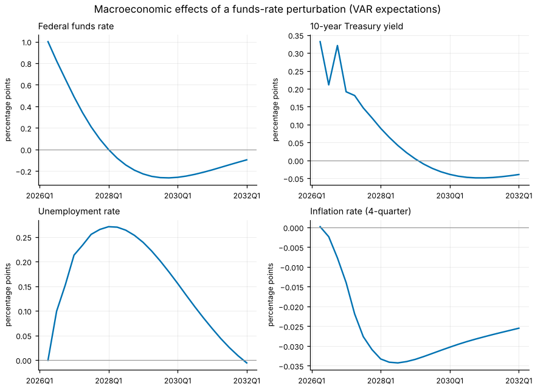
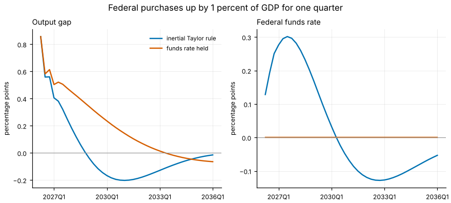
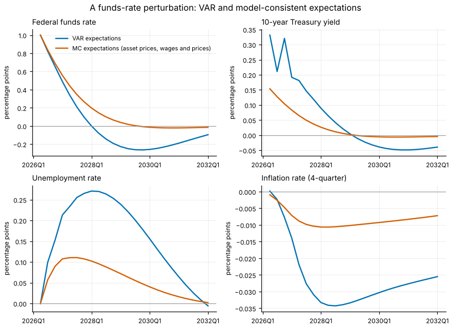
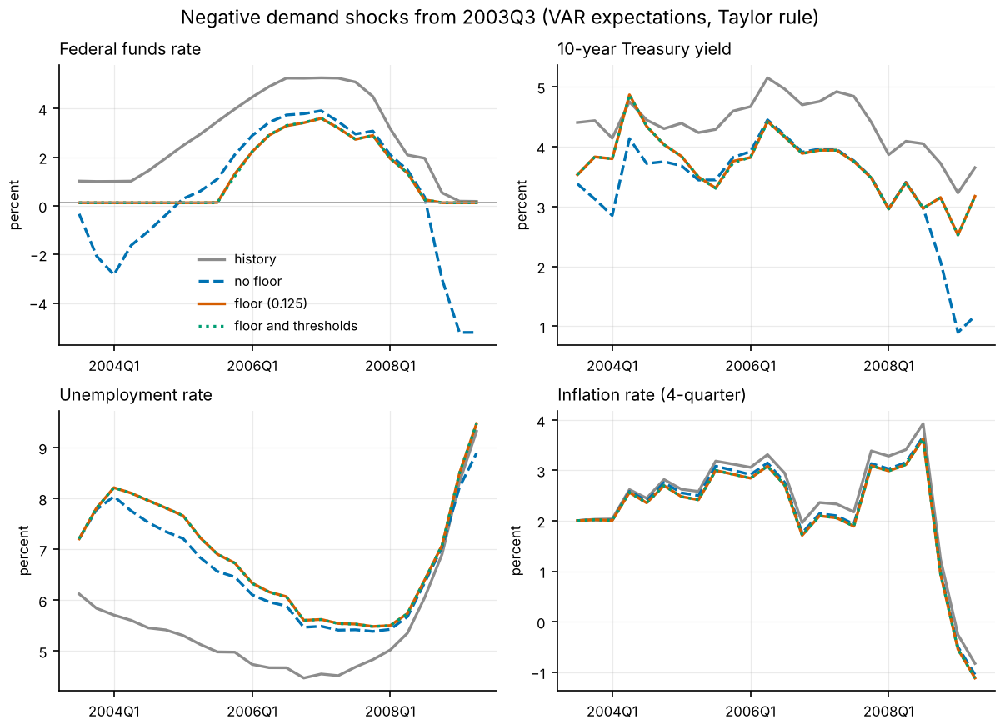
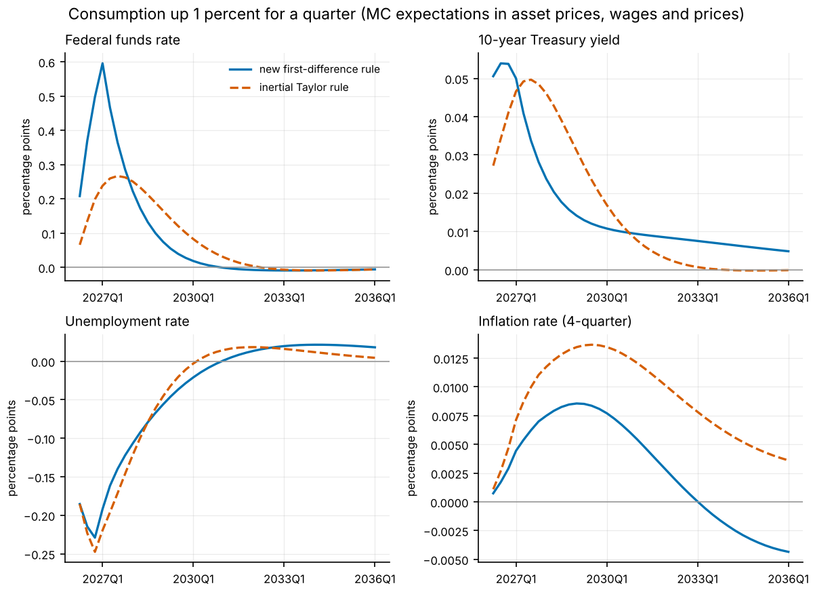
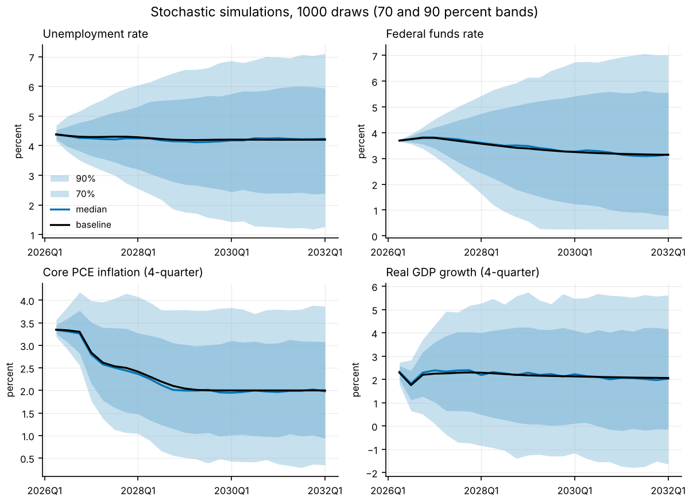
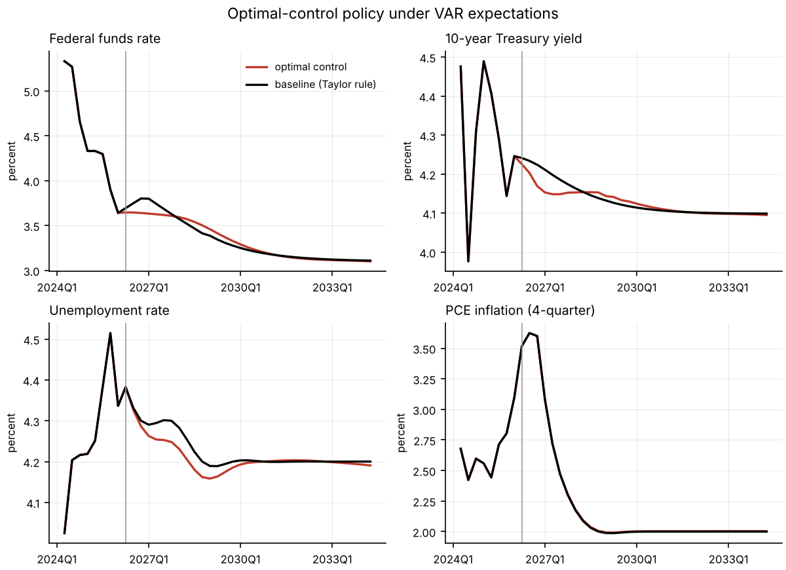

# FRB/US in pymetrix: a worked example

FRB/US is the Federal Reserve Board's large macroeconometric model of the US economy: about 280 equations, with
expectations that can be formed from small VARs or be model-consistent. The Board publishes the model, its data and
example simulation programs (for EViews, and a Python version). This page runs those examples in pymetrix: the
baseline tracked, a funds-rate shock, a fiscal shock, a change of policy rule, model-consistent expectations solved
by stacked Newton over 60 years, the zero lower bound with the FOMC's liftoff thresholds, a new policy rule
added to the model, stochastic simulations drawn from the model's historical errors, and an optimal-control path for
the funds rate.

**The model, its equations and its data are the Federal Reserve's public FRB/US packages. They are not part of
pymetrix and are not shipped with it.** Download them yourself to run this page. The figures below were made from the
packages of October 2026, with the data through 2026Q1.

## 1. Get the packages

From the FRB/US pages of the Federal Reserve Board's website
(<https://www.federalreserve.gov/econres/us-models-about.htm>, packages at
<https://www.federalreserve.gov/econres/us-models-package.htm>), download and unzip:

- **The model package (`frbus_package`).** It holds `mods/model.xml` (the equations and coefficients),
  `programs/example1.prg` to `example4.prg`, `pings.prg` and the other example programs, and `documentation/`. The
  documentation includes *FRB/US Simulation Basics*, the *MCE Solve Users' Guide*, the equations in HTML and notes
  such as Brayton's *A New FRB/US Price-Wage Sector*.
- **The data package (`data_only_package`).** It holds `LONGBASE.TXT` (history and a projection to 2176) and
  `HISTDATA.TXT` (history only).

The code below finds them through two environment variables. pymetrix's own tests use the same two:

```bash
export PYMETRIX_FRBUS=/path/to/frbus_package
export PYMETRIX_FRBUS_DATA=/path/to/data_only_package
```

## 2. Read the model

```python
import os
from pathlib import Path

import numpy as np
import pandas as pd

from pymetrix import optimal_control, read_eviews_xml
from pymetrix.data import Dataset
from pymetrix.figures import Fan, Figure, Line, Panel
from pymetrix.estimation import Equation
from pymetrix.models import GaussSeidel, Model, Newton, PerfectForesight, Scenario

package = Path(os.environ["PYMETRIX_FRBUS"])
data_package = Path(os.environ["PYMETRIX_FRBUS_DATA"])

frbus = read_eviews_xml(package / "mods" / "model.xml")
model = frbus.model
frbus                                # <EViewsXmlModel stdver: 284 equations, 365 exogenous>
frbus.template.labels["xgap2"]       # 'Output gap for GDP (100*(actual/potential -1)'
frbus.sectors["rff"], frbus.equations["rff"]   # 'Financial Sector', the EViews text of the equation
```

`read_eviews_xml` reads each variable's EViews equation through pymetrix's EViews reader. Coefficients such as
`y_ecd(1)` become parameters `y_ecd_1`, the names of the Fed's Python version. Each equation keeps its add-factor
series (`ecd_aerr`), which is exogenous. With no `mce=` argument the result is the standard model: all expectations
come from VARs, so the model has no leads.

## 3. Load LONGBASE and set the policy options

```python
longbase = pd.read_csv(data_package / "LONGBASE.TXT")
longbase.columns = [c.lower() for c in longbase.columns]
longbase.index = pd.PeriodIndex(longbase.pop("obs"), freq="Q", name="time")
last = pd.read_csv(data_package / "HISTDATA.TXT", usecols=[0]).iloc[-1, 0]
start = pd.Period(last, "Q") + 1      # the first projected quarter: 2026Q2 here


def settings(frame, monetary="dmpintay", fiscal="dfpsrp", rstar_from=None):
    """As the Fed's example programs set them: set_mp, set_fp, no zero bound or thresholds, rstar exogenous."""
    frame = frame.copy()
    for k in ("dmpex", "dmprr", "dmptay", "dmptlr", "dmpintay", "dmpalt", "dmpgen"):
        frame[k] = float(k == monetary)
    for k in ("dfpex", "dfpsrp", "dfpdbt"):
        frame[k] = float(k == fiscal)
    frame["dmptrsh"], frame["rffmin"], frame["drstar"] = 0.0, -9999.0, 0.0
    if rstar_from is not None:
        frame.loc[rstar_from:, "drstar"] = 1.0
    aerr = [f"{v}_aerr" for v in model.endogenous if f"{v}_aerr" not in frame.columns]
    return pd.concat([frame, pd.DataFrame(0.0, index=frame.index, columns=aerr)], axis=1)


frame = settings(longbase)
data = Dataset.from_frame(frame)
```

The switch variables pick the policy. Each is a series, so a switch can change during a simulation.

- **Monetary policy.** `dmpintay` selects the inertial Taylor rule. The others are `dmptay` (a Taylor rule),
  `dmptlr` (a Taylor rule with the unemployment gap), `dmpalt` (an estimated rule), `dmpex` (an exogenous nominal
  funds rate) and `dmprr` (an exogenous real funds rate).
- **Fiscal policy.** `dfpsrp` makes the trend tax rates stabilise the surplus ratios. The others are `dfpex`
  (exogenous trend tax rates) and `dfpdbt` (stabilise the debt ratios).

## 4. Track the baseline

The Fed's programs call `addassign` and `addinit` so that, with no shock, the model reproduces the baseline.
`Model.add_factors` does the same in pymetrix. It returns, for each equation, the equation's residual at the data,
and passing these to `Scenario(adjust=...)` makes every solver reproduce the data.

```python
span = (str(start), str(start + 39))                 # ten years
track = model.add_factors(data, span)
baseline = model.solve(data, span, Scenario(adjust=track, name="baseline")).frame.loc[start:start + 39]
```

To see that tracking holds, blank the endogenous variables over the span and solve again. Newton then starts from
the last historical values, and its solution should be LONGBASE's projection.

```python
blank = frame.copy()
blank.loc[start:start + 39, list(model.endogenous)] = np.nan
check = model.solve(Dataset.from_frame(blank), span, Scenario(adjust=track)).frame
# largest gap relative to max(1, |value|): 2.1e-8, in the 284 variables over the 40 quarters
```

## 5. A funds-rate shock (example1.prg)

`example1.prg` raises the inertial Taylor rule's add factor by one percentage point for one quarter. The responses
are the scenario's solution minus the baseline.

```python
def first(value):
    return {str(start): value}

shocked = model.solve(data, span, Scenario(adjust=track, shift={"rffintay_aerr": first(1.0)})).frame
d = (shocked - baseline).loc[start:start + 23]

def responses(d, title, **more):
    panels = []
    for v, name in (("rff", "Federal funds rate"), ("rg10", "10-year Treasury yield"),
                    ("lur", "Unemployment rate"), ("pic4", "Inflation rate (4-quarter)")):
        lines = [Line(d[v], "VAR expectations" if more else "")] + [Line(m[v], label) for label, m in more.items()]
        panels.append(Panel(tuple(lines), title=name, ylabel="percentage points", legend=bool(more) and v == "rff"))
    return Figure(tuple(panels), title=title, columns=2, width=8)

fig = responses(d, "Macroeconomic effects of a funds-rate perturbation (VAR expectations)")
fig.axhline(0, ax="all", color="0.6", lw=0.8).save("frbus_funds_rate.png")
```



The output gap falls to -0.50 after two years. The funds rate is back at baseline after two years and a little below
it after that, and inflation falls by a few hundredths. These are the shapes the Fed's documentation shows for this
shock (Brayton, *A New FRB/US Price-Wage Sector*, Figure 3, p. 16, made with an earlier vintage of the model).

The solver can be Newton's method (the default) or Gauss-Seidel. On this shock the two agree to 1e-11.

```python
gs = model.solve(data, (str(start), str(start + 11)), Scenario(adjust=track, shift={"rffintay_aerr": first(1.0)}),
                 solver=GaussSeidel(tol=1e-9, max_iter=5000))
```

Gauss-Seidel needs a few hundred sweeps a quarter on FRB/US, so Newton is much faster. Its tolerance applies to
the residuals as written, and some FRB/US equations are in levels of tens of thousands, so 1e-10 is below what
rounding allows.

## 6. A fiscal shock

`pings.prg` raises federal purchases (`egfe`) by 1 percent of baseline GDP for one quarter, through the equation's
add factor:

```python
size = 0.01 * frame.loc[start, "xgdpn"] / frame.loc[start, "egfen"]
fiscal = model.solve(data, span, Scenario(adjust=track, shift={"egfe_aerr": first(size)})).frame.loc[start:start + 39]
share = 100 * (fiscal.egfen / fiscal.xgdpn - baseline.egfen / baseline.xgdpn)   # 1.07 points of GDP on impact
gap = fiscal.xgap2 - baseline.xgap2                                             # 0.86 on impact
```

- **Impact.** The output gap rises by 0.80 percentage points for each point of GDP spent.
- **Afterwards.** The response decays and turns negative in the third year, as monetary policy tightens. The Fed's
  Figure 3 shows about 1.0 on impact and a dip below zero from the third year.
- **Linearity.** Doubling the shock doubles the responses to within 0.7 percent for the output gap and 1.5 percent
  for the funds rate. Only the model's nonlinearities separate them.

## 7. A different policy rule

Switching to `dmpex` holds the funds rate at its exogenous path (`rfffix`). The scenario sets the switches over the
simulation and is compared with the same switches without the shock:

```python
def under(rule, **changes):
    switches = {k: float(k == rule) for k in ("dmpex", "dmprr", "dmptay", "dmptlr", "dmpintay", "dmpalt")
                if k in model.exogenous}
    return model.solve(data, span, Scenario(adjust=track, set=switches, **changes)).frame.loc[start:start + 39]

held = under("dmpex", shift={"egfe_aerr": first(size)}) - under("dmpex")
inertial = fiscal - baseline
fig = Figure((Panel((Line(inertial.xgap2, "inertial Taylor rule"), Line(held.xgap2, "funds rate held")),
                    title="Output gap", ylabel="percentage points"),
              Panel((Line(inertial.rff, "inertial Taylor rule"), Line(held.rff, "funds rate held")),
                    title="Federal funds rate", ylabel="percentage points", legend=False)),
             title="Federal purchases up by 1 percent of GDP for one quarter", columns=2, width=8)
fig.axhline(0, ax="all", color="0.6", lw=0.8).save("frbus_fiscal.png")
```



With the funds rate held, the same spending raises output more: the output gap summed over the first two years is
4.5 point-quarters, against 3.5 under the inertial Taylor rule. A shock to the plain Taylor rule (`dmptay`,
`rfftay_aerr`) is undone the next quarter, while the inertial rule takes years.

## 8. Model-consistent expectations (example2.prg)

`mce=` reads the model-consistent versions of the expectations equations instead of the VAR ones. `example2.prg`
uses `"-mcap+wp"`: asset pricing (`zrff10 = ...zrff10(1)`, `zpic58 = pic4(8)` and others) and price and wage
setting (`zpicxfe = picxfe(1)`, `zpieci = pieci(1)`). These are the groups `mcap` and `mcwp` in `model.xml`:

```python
mce = read_eviews_xml(package / "mods" / "model.xml", mce=["mcap", "mcwp"]).model
mframe = settings(longbase, rstar_from=start + 40)   # example2.prg: rstar endogenous after ten years
mdata = Dataset.from_frame(mframe)
horizon = (str(start), str(start + 239))              # 60 years; LONGBASE beyond gives the terminal values
mtrack = mce.add_factors(mdata, horizon)
pf = PerfectForesight(terminal="data", tol=1e-8)
mshock = mce.solve(mdata, horizon, Scenario(adjust=mtrack, shift={"rffintay_aerr": first(1.0)}), solver=pf)
md = (mshock.frame - mframe).loc[start:start + 23]
```

**How the methods differ.** The Fed's programs solve this model with the algorithms of `mce_solve_library.prg`.
They alternate between the backward-looking model and the model-consistent identities, adjusting add factors until
the expectation errors vanish. `PerfectForesight` instead solves all 240 quarters of all 284 equations at once, as
one system of 68,160 equations, by Newton's method with a sparse Jacobian. On this machine:

- **The shock above:** 6 seconds and 2 iterations, with a peak memory of about 0.9 GB.
- **The baseline from blanked starting values over the first ten years:** 16 seconds and 4 iterations.

**The tracking add factors.** They are computed with the model-consistent equations, so the baseline solves this
model too. With no shock, the solution is LONGBASE (8e-9 relative at worst), and every equation holds in every
period (largest residual below 1e-8).

**Comparing with VAR expectations.** The VAR responses come from the standard model with the same settings:

```python
vtrack = model.add_factors(mdata, span)
vd = (model.solve(mdata, span, Scenario(adjust=vtrack, shift={"rffintay_aerr": first(1.0)})).frame - mframe).loc[start:start + 23]
fig = responses(vd, "A funds-rate perturbation: VAR and model-consistent expectations",
                **{"MC expectations (asset prices, wages and prices)": md})
fig.axhline(0, ax="all", color="0.6", lw=0.8).save("frbus_mce.png")
```



With model-consistent expectations:

- **The 10-year yield.** It rises by 0.15 on impact, against 0.33 under VAR expectations. Of that, 0.13 is
  `zrff10`, the expected funds rate over ten years: a discounted average of the path that markets now foresee, which
  fades. The rest is the term premium.
- **The other responses.** Unemployment rises by 0.11 at most (0.27 under VAR expectations) and inflation falls by
  0.01 (0.03). This is the pattern of the Fed's Figures 3 and 5 in the price-wage note (pp. 16 and 18).

## 9. The zero lower bound and liftoff thresholds (example3.prg)

`example3.prg` runs on history. From 2003Q3, when the funds rate was about 1 percent, it adds the demand and
risk-premium shocks of the financial crisis: the equation errors of consumption (`eco`, `ecd`), housing (`eh`),
business investment (`ebfi`) and the BBB spread (`rbbbp`) in the four quarters from 2008Q4. The policy rule is
the plain Taylor rule, and the simulation runs 24 quarters under VAR expectations.

Two switches constrain the funds rate. Both act in the funds-rate equation:

```
rff = (1 - dmptrsh)*max(rffrule, rffmin)
      + dmptrsh*max(dmptr[-1]*rffrule + (1 - dmptr[-1])*rffmin, rffmin) + rff_aerr
```

- **The floor.** `rffmin` is the lowest funds rate. The program sets it to 0.125; -9999 removes it.
- **The thresholds.** With `dmptrsh` = 1, the rate stays at the floor until unemployment falls below `lurtrsh`
  or expected inflation (`zpic58`) rises above `pitrsh`. These are the FOMC's thresholds of December 2012 to
  January 2014. The switch `dmptr` records the crossing. It is the max of its own lag and of `dmptlur` and
  `dmptpi`, logistic functions of the two gaps (slope 25), so it stays on once on. The rule takes over a quarter
  after it turns on.

The program sets the thresholds to 7 percent and 3 percent from the fifth quarter, when the shocks have pushed
unemployment above 7. In the first four quarters `lurtrsh` and `pitrsh` are ±9999 and `dmptr` is 0, so the switch
cannot turn on early. It computes tracking add factors to 2012Q4 and then sets those of the policy equations to
zero, so that the floor and the thresholds apply to the simulated funds rate itself. It puts the shocks in place
of the tracking add factors in their four quarters (`eco_a.fill`):

```python
zlb_start = pd.Period("2003Q3", "Q")
rows = pd.period_range(zlb_start, periods=24, freq="Q")
shocks = {"eco": (-.006, -.006, -.011, -.001), "ecd": (-.091, -.018, -.021, .029),
          "eh": (-.076, -.078, -.040, .073), "ebfi": (-.114, -.108, .050, .049), "rbbbp": (2.70, 0.38, -0.89, -1.35)}


def zlb_scenario(floor=True, thresholds=True):
    frame = settings(longbase, monetary="dmptay")
    frame["rffmin"] = 0.125 if floor else -9999.0
    if thresholds:
        frame.loc[zlb_start - 1:zlb_start + 3, ["dmptrsh", "lurtrsh", "pitrsh", "dmptr"]] = [0, -9999, 9999, 0]
        frame.loc[zlb_start + 4:, ["dmptrsh", "lurtrsh", "pitrsh"]] = [1, 7.0, 3.0]
    factors = model.add_factors(Dataset.from_frame(frame), (str(zlb_start), "2012Q4"))
    for name in ("rfftay", "rffrule", "rff", "dmptpi", "dmptlur", "dmptmax", "dmptr"):
        factors[name] = 0 * factors[name]
    for name, values in shocks.items():
        factors[name] = factors[name].copy()
        factors[name].loc[rows[:4]] = 0.0
        frame.loc[rows[:4], f"{name}_aerr"] = values
    span = (str(rows[0]), str(rows[-1]))
    return model.solve(Dataset.from_frame(frame), span, Scenario(adjust=factors)).frame.loc[rows]


free, zlb, thresholds = zlb_scenario(False, False), zlb_scenario(True, False), zlb_scenario(True, True)
```

`free` is the same scenario without the floor. The Fed's program has a third setting, with no floor and the
tracking add factors kept, which gives deviations from history. That setting is not used here.



**The floor binds.** Without it, the Taylor rule takes the funds rate to -5.2 in 2009Q1. With it, the rate is
0.125 from 2003Q3 to 2005Q2 and again from 2008Q4, and it equals the rule wherever the rule is above the floor.
Because the floor stops the rate from falling:

- **Unemployment** peaks at 9.5 percent instead of 8.9.
- **The output gap** reaches -7.3 instead of -6.2.
- **The 10-year yield** bottoms at 2.5 percent instead of 0.9.

**The thresholds delay liftoff by one quarter.** Unemployment falls below 7 in 2005Q3 (6.90). `dmptr` is 0.003 in
2005Q2 and 0.92 in 2005Q3, so liftoff comes in 2005Q4 instead of 2005Q3. Expected inflation never reaches 3. The
delay is short here, because the rule itself would lift off in 2005Q3. The effect is at most 0.10 points on the
funds rate and less than 0.01 on unemployment.

**Checks.** The checks in `tests/test_frbus_example.py` verify, quarter by quarter:

- **The floor.** The funds rate is never below the floor (to 1e-8), and every equation holds in every quarter
  (largest residual below 1e-8).
- **The switches.** From the fifth quarter, `dmptlur` is above 1/2 exactly when unemployment is below 7, and
  `dmptpi` exactly when `zpic58` is above 3. `dmptr` is the max of `dmptmax` and its own lag. The funds rate stays
  at the floor until the quarter after `dmptr` turns on.

The Fed's documentation for this example (*FRB/US Simulation Basics*, pp. 5-6) gives no numbers to compare with.
The values above are sanity checks only.

**The solvers.** Newton's method handles both maxima, at about 1 second for the 24 quarters. Two points need care:

- **The ±9999 thresholds.** They make `exp` overflow in the derivative of the logistic switch: inf/inf.
  `Newton` replaces any derivative that does not evaluate with a forward difference. Here the function is flat, so
  that derivative is 0.
- **Gauss-Seidel.** Undamped, it overshoots in these quarters to a negative stock-market wealth, whose log fails.
  With `damping=0.5` it converges in about 30 seconds and agrees with Newton to 1e-9.

## 10. A new policy rule (example4.prg)

`example4.prg` replaces the generalised rule `rffgen` with a first-difference rule. The rule depends on the
expected output gap and inflation three quarters ahead, two new expectations:

```
rffgen = rff(-1) + .5*(zpic43 - pitarg) + .5*(zgap3 - zgap3(-4))
zgap3 = xgap2(3)          zpic43 = picx4(3)        (model-consistent)
```

`set_mp("dmpgen")` then selects the new rule, under model-consistent expectations in asset pricing and price-wage
setting. pymetrix builds the new model from the old one's equations. It replaces `rffrule` and adds the three new
equations:

```python
pi4 = "(picxfe + picxfe[-1] + picxfe[-2] + picxfe[-3])/4"
new_rule = Equation(f"rffgen ~ g_rff*rff[-1] + (1 - g_rff)*(rstar + {pi4} + g_pi*({pi4} - pitarg) + g_gap*xgap2)"
                    " + g_zpi*(zpic43 - pitarg) + g_zgap*(zgap3 - zgap3[-4])",
                    params=["g_rff", "g_pi", "g_gap", "g_zpi", "g_zgap"], name="rffgen")
fed_rule = {"g_rff": 1.0, "g_pi": 0.0, "g_gap": 0.0, "g_zpi": 0.5, "g_zgap": 0.5}
equations = [Equation(e.text + " + dmpgen*rffgen", name="rffrule") if e.name == "rffrule" else e
             for e in mce.equations]
equations += [new_rule, Equation("zgap3 = xgap2[+3]", name="zgap3"), Equation("zpic43 = picx4[+3]", name="zpic43")]
mce4 = Model(equations, params={**mce.params, **fed_rule})
```

**Why `rffrule` changes.** In the model of October 2026, the `rffrule` equation no longer has the term
`dmpgen*rffgen`, though the 2021 README shows it and the equation's own list of variables still names `rffgen`
and `dmpgen`. Without the term, `dmpgen` = 1 would leave the funds rate at its add factor, so the term is added
back.

**The coefficients.** The rule is written with coefficients, so one equation holds both rules:

- **The Fed's rule:** `g_rff` = 1 removes the Taylor-rule part, and `g_zpi` = `g_zgap` = 0.5.
- **The inertial Taylor rule:** `g_rff` = 0.85, `g_pi` = 0.5, `g_gap` = 1 and the new terms at zero.

A `Regime` can replace equations by name but not add new ones. Building the `Model` from the edited list of
equations is the route that adds them.

**The other new equations.** In the Fed's MCE algorithm, each new expectation also needs a backward-looking
version (`zgap3 = .5*xgap2(-1)`), its `w` form and an error variable. In pymetrix the model-consistent equation is
the equation, and stacked Newton solves it directly.

The data need the new variables at their baseline values:

```python
frame4 = settings(longbase, monetary="dmpgen", rstar_from=start + 40)
frame4["rffgen"], frame4["zgap3"], frame4["zpic43"] = frame4.rff, frame4.xgap2.shift(-3), frame4.picx4.shift(-3)
data4 = Dataset.from_frame(frame4)
track4 = mce4.add_factors(data4, horizon)
shock = Scenario(adjust=track4, shift={"eco_aerr": first(0.01)})   # consumption up 1 percent for a quarter
d4 = (mce4.solve(data4, horizon, shock, solver=pf).frame - frame4).loc[start:start + 39]
```



**The responses.** The new rule raises the funds rate faster: 0.50 after three quarters, against 0.20 under the
inertial Taylor rule. It peaks at 0.60 in the fourth quarter, against 0.27 for the inertial rule, and is back near
baseline sooner. Inflation rises less, by 0.009 at most against 0.014. The 10-year yield rises 0.05 on impact against 0.03,
and the output gap closes sooner. Each run takes about 7 seconds and 2 Newton iterations over the 240 quarters.

**Checks.** The checks verify two things:

- **The new equations hold.** `rffgen`, the rule written out from the solution, agrees with the solution's path to
  1e-8, `rffrule` equals `rffgen`, and every equation holds in every quarter.
- **The same coefficients give the same answer.** With the new rule given the inertial Taylor rule's coefficients
  (`mce4.with_parameters(...)`), the responses equal those under `dmpintay`: to 1.3e-12 in the funds rate, the
  yield, unemployment, inflation and the output gap, and to 1e-8 relative in every variable.

The Fed's documentation shows no results for this example, so the sizes are sanity checks only.

**Line search scaled to each equation.** Before this example, stacked Newton stalled on this shock. Its line
search judged a step by the norm of the raw residuals. A 1 percent move in consumption leaves second-order
residuals of about 0.7 in nominal identities whose levels are in the thousands. That is far smaller than the
levels but larger than the shock's own residual of 0.01, so the step was cut again and again. The line search now
scales each residual by the size of its equation's terms, and convergence is still judged on the residuals as
written. The funds-rate shock of section 8 also benefits: 6 seconds and 2 iterations, instead of 11 seconds and 3.

## 11. Stochastic simulations (stochsim.prg)

`stochsim.prg` simulates the model many times under VAR expectations, each time with shocks drawn from history, for
the distribution of the projection. As the program does it:

- **The shocks.** The stochastic equations are those whose `stochastic_type` in `model.xml` is not `NO`, with
  `leo` left out: 51 equations. Their errors are the tracking add factors over 1970Q1 to 2014Q4, de-meaned.
- **The draws.** Each draw takes, for each simulated quarter, the errors of one historical quarter picked at random
  with replacement, all 51 together, so their correlations are kept (`%errorblock = 1`). The first quarter's shocks
  are halved (`%q1_shock_damp = .5`), for a quarter already partly known.
- **Policy.** The inertial Taylor rule, with the funds rate floored at 0.25. In the first quarter half the rate
  follows the rule and half is held at its exogenous value, `rfffix` (`%rff_weight_q1 = .5`: `dmpintay` =
  `dmpex` = 0.5). Fiscal
  policy is exogenous (`dfpex`).
- **The run.** 1000 draws over 24 quarters, seed 12345. The program also appends a 4-quarter GDP growth equation,
  `anngr`.

In pymetrix the historical errors are a DataFrame of residuals by equation. `Model.solve` resamples it a quarter at a
time with `errors=`, and `error_scale` halves the first quarter:

```python
stochastic = [v for v, kind in frbus.stochastic.items() if kind != "NO" and v != "leo"]   # 51 equations

smodel = Model([*model.equations, Equation("anngr = 100*(xgdp/xgdp[-4] - 1)", name="anngr")], params=model.params)
sframe = settings(longbase, fiscal="dfpex")
sframe["anngr"] = 100 * (sframe.xgdp / sframe.xgdp.shift(4) - 1)
sframe["rffmin"] = 0.25
sframe.loc[start, ["dmpintay", "dmpex"]] = 0.5
sdata = Dataset.from_frame(sframe)

history = smodel.add_factors(sdata, ("1970Q1", "2014Q4"))
errors = pd.DataFrame({v: history[v] for v in stochastic})
errors = errors - errors.mean()                              # 180 quarters by 51 equations

sspan = (str(start), str(start + 23))
strack = smodel.add_factors(sdata, sspan)
sims = smodel.solve(sdata, sspan, Scenario(adjust=strack), solver=Newton(tol=1e-8), draws=1000, seed=12345,
                    errors=errors, error_scale={str(start): 0.5})
bands = sims.bands((0.7, 0.9), ["rff", "lur", "picxfe", "picnia", "picx4", "xgap2", "hggdp", "anngr"])
```

**The floor in the baseline.** When the baseline funds rate is within 25 basis points of the floor, the program
recomputes the rule's add factors so that the floor applies to the simulated rate. Here the baseline is 2.9 points
above the floor at its lowest, so the tracking add factors stand, as in the program.

**The solver.** Newton's tolerance is 1e-8 because FRB/US has levels in the tens of thousands, and 1e-10 is below
what rounding allows there.

```python
names = {"lur": "Unemployment rate", "rff": "Federal funds rate", "picx4": "Core PCE inflation (4-quarter)",
         "anngr": "Real GDP growth (4-quarter)"}
base = sframe.loc[start:start + 23]
panels = [Panel((Fan.from_frame(bands, v, (0.7, 0.9), label="median", start=False), Line(base[v], "baseline", color="black")),
                title=title, ylabel="percent", legend=v == "lur") for v, title in names.items()]
Figure(tuple(panels), title="Stochastic simulations, 1000 draws (70 and 90 percent bands)", columns=2, width=8).save("frbus_stochsim.png")
```



`bands` gives the median and the bands, and `sims.simulation` holds the draws themselves (draws by quarters by
variables) with the errors drawn (`sims.simulation.errors`). Six years out, in 2031Q4:

| | baseline | median | 70 percent band | 90 percent band | s.d. |
|---|---|---|---|---|---|
| Unemployment rate | 4.20 | 4.22 | 2.37 to 5.99 | 1.18 to 7.03 | 1.82 |
| Federal funds rate | 3.15 | 3.10 | 0.82 to 5.56 | 0.25 to 7.01 | 2.14 |
| Core PCE inflation (4-quarter) | 2.00 | 2.02 | 1.01 to 3.09 | 0.36 to 3.89 | 1.07 |
| Real GDP growth (4-quarter) | 2.07 | 1.97 | -0.14 to 4.23 | -1.51 to 5.57 | 2.23 |

**The zero lower bound.** The floor binds when the rule asks for less than 0.25, so the draws of `rffrule` show
where:

```python
floor = sims.simulation["rffrule"] < 0.25        # quarters by draws
floor.mean(axis=1)                               # by quarter: 0 in the first five, 0.09 in the last
floor.any().mean()                               # 0.16: at least once in the six years
```

**What is checked.** Most of these checks run in `tests/test_frbus_example.py`, on 200 draws over 12 quarters:

- **No shocks.** With every error zero, every draw is the baseline, which is LONGBASE (1e-8 relative).
- **Reproducibility.** The same seed gives the same draws, and another seed different ones. So does the Mersenne
  Twister (`pymetrix.random_generator("mt19937")`), whose draws differ from those of the default generator. The
  solutions repeat exactly with current NumPy. With NumPy 1.26 they differ by up to 5e-11 relative from one run to
  the next, from rounding in its OpenBLAS, so the tests compare them to 1e-9.
- **The draws come from history.** Each draw's errors in each quarter are exactly one historical quarter's 51
  errors, halved in the first quarter. The add factors that a draw's own solution implies are the tracking add
  factors plus those errors (1e-6).
- **The median.** The shocks are de-meaned, so the median should stay near the baseline. It does: within 0.1 for
  the funds rate, unemployment and inflation (0.094 at most), and 0.14 for the output gap and GDP growth, over the
  24 quarters. The 90 percent bands are 3.5 to 9 points wide by then.
- **The variance, on a model whose answer is known.** For `y = 0.5*y[-1] + e`, with `e` resampled from 300
  residuals, the variance after h quarters is s² (1 + 0.25 + ... + 0.25^(h-1)). With 20,000 draws the simulated
  variance is within 2.3 percent of it in every quarter.

The Fed's documentation gives no numbers for this program (*FRB/US Simulation Basics*, p. 4, only describes the
`m_stoch` list), so the FRB/US values above are sanity checks only.

**How long it takes.** The 1000 draws over 24 quarters take 105 seconds on this machine, and 500 draws over 40
quarters take 96 seconds. All the draws are solved together, period by period, from the compiled equations:

- **The chord method first.** One Jacobian, the draws' mean, is factored once a quarter. It settles most of the
  draws: 84 to 100 percent of them in each quarter, in a run of 100 draws over 8 quarters.
- **Newton's method for the rest.** The remaining draws get Newton's method with their own Jacobians.

`workers=4` splits the draws between four processes. The errors are drawn first, in the calling process, so the
draws are the same; the solutions agree to the solver's tolerance (7e-7 relative). The machine used here has about
one core's worth of CPU, so the processes did not save time (180 seconds against 96).

The Fed's program is for VAR expectations. Stochastic simulation with model-consistent expectations would solve
each draw's whole path again every quarter, and is not tried here.

## 12. Optimal-control policy (ocpolicy.prg)

`ocpolicy.prg` replaces the policy rule with the funds-rate path that minimises a loss, as in the Board's optimal-
control simulations:

- **The loss.** Squared deviations of unemployment from its natural rate (`ugap`), of 4-quarter PCE inflation
  (`pic4`) from 2 percent, and of the quarterly change in the funds rate (`delrff`). All three have weight 1, and
  the losses are discounted at 0.99 a quarter.
- **The horizons.** The loss is summed over 80 quarters, and the funds rate is chosen for the first 60.
- **The instrument.** The plain Taylor rule's add factor, `rfftay_aerr`, moved in each of the 60 quarters, so the
  rule's own path is the baseline.
- **The other settings.** The equilibrium real rate is endogenous (`drstar` = 1). Fiscal policy is exogenous for 20
  quarters and follows the debt rule after.

`optimal_control` solves this problem for a model solved period by period:

```python
omodel = Model([*model.equations, Equation("ugap = lur - lurnat", name="ugap")], params=model.params)
oframe = settings(longbase, monetary="dmptay", fiscal="dfpex", rstar_from=start)
oframe.loc[start + 20:, ["dfpex", "dfpdbt"]] = [0.0, 1.0]
oframe["ugap"] = oframe.lur - oframe.lurnat
odata = Dataset.from_frame(oframe)
ospan = (str(start), str(start + 79))
otrack = omodel.add_factors(odata, ospan)
oc = optimal_control(omodel, odata, ospan, instruments=["rfftay_aerr"], loss={"ugap": 1.0, "pic4": 1.0, "delrff": 1.0},
                     desired={"pic4": 2.0}, control=(str(start), str(start + 59)), discount=0.99,
                     scenario=Scenario(adjust=otrack), solver=Newton(tol=1e-8))
oc        # <OptimalControl: loss 10.8141 (baseline 11.7622), 3 iterations, gradient norm 2.12e-07>
```

**How it is solved.** The method is the one the *MCE Solve Users' Guide* describes for its `opt` simulations
(section 5, pp. 15-16):

1. **Linearise.** At the current path, the targets are linear in the instrument, y - y0 = D (x - x0).
2. **Minimise.** The quadratic loss in that linear model is minimised, a least-squares problem.
3. **Repeat.** The model is solved again at the new path, until the solutions agree.

For a linear model one step is the optimum. pymetrix computes D from the model itself. It takes one pass through
the 80 quarters along the solution, solving each quarter's Jacobian for the response of every variable to every
move. The Fed's program instead adds a penalty to the loss for the zero lower bound. pymetrix imposes no bound, and
here the optimal funds rate stays above 2.5, where that penalty would be below 1e-20.

The program sets the natural rate to the SEP's 4.8 percent through 2025. The simulation here starts in 2026Q2, so
`lurnat` is used throughout. The whole run takes 12 seconds.



**The optimal path against the Taylor rule.** The rule raises the funds rate from 3.69 to 3.80 over the first
year. The optimal path holds it near 3.65 instead, because the loss penalises changes in the rate and unemployment
above its natural rate. It then cuts more slowly than the rule, and is above it from 2028.

- **Unemployment** is up to 0.05 lower, 4.25 against 4.30 in 2027Q4.
- **The 10-year yield** is 0.05 lower in the first year.
- **Inflation** hardly moves under VAR expectations: within 0.01 of the baseline.
- **The loss** falls from 11.76 to 10.81.

The baseline itself, LONGBASE, has unemployment falling from 4.2 to about 3.3 percent in 2041. The optimal path sees this
coming, as its loss runs through 2046Q1, and raises the rate from 2037.

**Checks:**

- **On a model whose answer is known.** The model is a small backward-looking one: an IS curve, a Phillips curve, a
  rule and the rate's change, with the loss y² + π² + Δi², discounted at 0.99. After an inflation shock,
  `optimal_control` over 200 quarters gives pymetrix's analytic optimal policy under commitment (`optimal_policy`,
  its impulse response): 5e-15 over the first 40 quarters, in one iteration. This checks the method before FRB/US.
- **The first-order conditions.** At the optimum, the gradient of the loss in the 60 moves is 2e-7 of its size at
  the baseline.
- **The gradient itself.** At the baseline, the gradient from the linearised model equals central differences of
  the loss to 1e-6 relative.
- **The loss and the path.** The loss is below the Taylor rule's, the moves stop after the 60th quarter, and every
  equation holds along the path.

The Fed's documentation gives no results for this program, so the FRB/US numbers are sanity checks only. The
program can also be run with model-consistent expectations (its `-mcap+wp`). That needs D from the stacked
perfect-foresight system, which `optimal_control` does not compute, so it is not tried here.

## What this page does not cover

- **The zero lower bound with model-consistent expectations.** `example3.prg` imposes the floor and the thresholds
  under VAR expectations only, and so does this page. Under perfect foresight the `max` would be a kink inside the
  stacked system. That case is not tried or tested here. pymetrix's OccBin regimes handle occasionally binding
  constraints in linearised models, not in FRB/US's nonlinear equations.
- **The rest of `mce_solve_library.prg`.** Its quasi-Newton algorithm, its `terminal` option for permanent shocks,
  optimal control with model-consistent expectations, and its time-consistent optimisation (`opttc`) are not
  reproduced. For a permanent shock, give `PerfectForesight` terminal values from a longer simulation or a steady
  state yourself.
- **Bounds in optimal control.** `ocpolicy.prg`'s penalty for the zero lower bound is not imposed. Add a penalty
  variable to the model and to the loss if a path needs it.
- **Stochastic simulation with model-consistent expectations.** `stochsim.prg` is for VAR expectations, and so is
  section 11.
- **Who checked what.** pymetrix checks its own solution of the Fed's equations, as above. It does not run EViews
  or compare its results with the Fed's own.

The checks behind this page are in `tests/test_frbus_example.py`. They run when `PYMETRIX_FRBUS` and
`PYMETRIX_FRBUS_DATA` are set. Without the packages, they run on the excerpt of the model in the repository: six
equations and their data.
